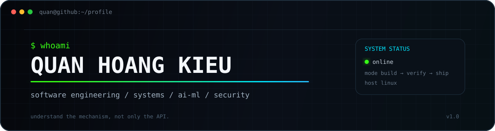

<div align="center">



<br/>

<a href="#-featured-projects"></a>
<a href="#-stack"></a>
<a href="#-engineering-mode"></a>

</div>

<br/>

<table>
<tr>
<td width="58%" valign="top">

### `> profile.load()`

```text
identity  : Quan Hoang Kieu
role      : Information Technology student @ International University, VNU-HCM
focus     : software engineering · systems · AI/ML · security
platform  : Linux
method    : build → inspect → verify → refine
```

I build software by going below the abstraction layer.

I am especially interested in **browser internals, real-time systems, low-level computing, failure recovery, deployment, practical AI tooling, and secure system design**.

The goal is not just to make software work — it is to understand why it works, how it fails, and how to make the failure visible.

</td>
<td width="42%" valign="top">

### `> current_processes`

```text
[RUNNING] software engineering
[RUNNING] systems / architecture
[RUNNING] AI & PyTorch
[RUNNING] web engineering
[RUNNING] cybersecurity
[IDLE   ] boring software
```

```text
uptime   : learning continuously
shell    : bash
editor   : vscode
coffee   : probably
```

</td>
</tr>
</table>

---

## `// FEATURED PROJECTS`

<!--
╔══════════════════════════════════════════════════════════════════════╗
║                    EASY PROJECT PIN CONFIG                         ║
╠══════════════════════════════════════════════════════════════════════╣
║ To change a card, edit ONLY the repo name in its PIN_SLOT block.   ║
║ Each repo name appears exactly twice:                              ║
║   1) GitHub link                                                   ║
║   2) &repo= value in the card image                                ║
║                                                                    ║
║ PIN_SLOT_1 = Rach_Doi_Son_Ha                                      ║
║ PIN_SLOT_2 = Edusoft-Course-Registration                          ║
╚══════════════════════════════════════════════════════════════════════╝
-->

<table>
<tr>
<td width="50%" valign="top">

<!-- PIN_SLOT_1 — replace Rach_Doi_Son_Ha in the TWO places below -->
<a href="https://github.com/hoangquan91029/Rach_Doi_Son_Ha">

</a>

</td>
<td width="50%" valign="top">

<!-- PIN_SLOT_2 — replace Edusoft-Course-Registration in the TWO places below -->
<a href="https://github.com/hoangquan91029/Edusoft-Course-Registration">

</a>

</td>
</tr>
</table>

<div align="right"><sub><code>PIN_SLOT_1</code> · <code>PIN_SLOT_2</code> — swap repos without rewriting descriptions</sub></div>

---

## `// STACK`

<div align="center">


</div>

<br/>

<table>
<tr>
<td width="33%" valign="top">

### `01 / build`

**JavaScript · Python · C · C++ · SQL**

Web apps, browser extensions, systems exercises, data workflows and ML experiments.

</td>
<td width="33%" valign="top">

### `02 / systems`

**Linux · MIPS · Networking · Docker**

Interested in what happens beneath frameworks: execution, memory, protocols and deployment.

</td>
<td width="33%" valign="top">

### `03 / intelligence`

**PyTorch · ML · AI tooling**

Learning model training while exploring practical ways to integrate AI into useful software.

</td>
</tr>
</table>

---

## `// ENGINEERING MODE`

<table>
<tr>
<td width="52%" valign="top">

```text
[01] understand the mechanism, not only the API
[02] make failure states explicit
[03] design for inspection and debugging
[04] verify assumptions with evidence
[05] ship → measure → refine
```

</td>
<td width="48%" valign="top">

```text
$ cat mindset.txt

simple      > clever
observable  > mysterious
verified    > assumed
working     > theoretical
improving   > perfect
```

</td>
</tr>
</table>

---

## `// SYSTEM SIGNAL`

<div align="center">


<br/><br/>


</div>

---

<div align="center">

```text
quan@github:~$ echo $NEXT_TARGET
build something worth understanding.
```

<sub>Vietnam · Software Engineering · Systems · AI/ML · Cybersecurity</sub>

</div>
